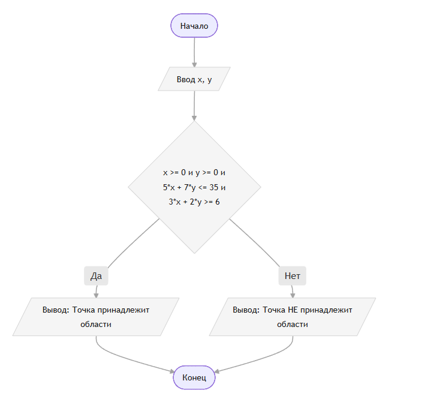
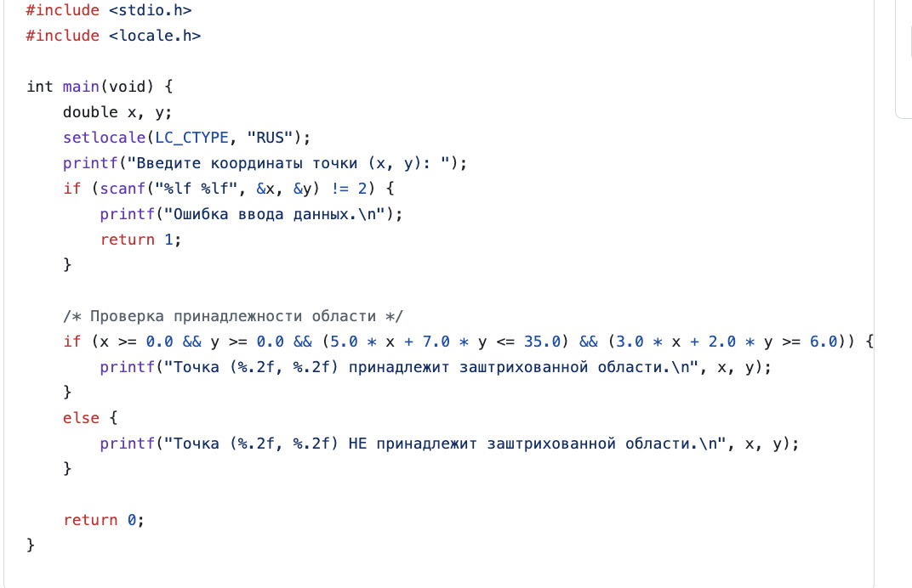

# Домашнее задание к работе 6
## Задача:
Составить программу, которая проверяет принадлежит ли заданная пользователем точка с координатами (х, у) заданным закрашенным (заштрихованным) областям, показанным на рисунках в табл., и выводит на экран сообщение.
## 1. Алгоритм и блок-схема
### Алгоритм
1.Начало программы.
2.Ввод данных: запросить у пользователя действительные числа x и y.
3.Проверка условия:
Вычислить истинность выражения:
(x >= 0) И (y >= 0)  И  (5x + 7y <= 35)  И  (3x + 2y >= 6).
4.Если условие истинно (Да) — вывести на экран сообщение: Точка принадлежит заштрихованной области.
5.Если условие ложно (Нет) — вывести на экран сообщение: Точка не принадлежит заштрихованной области.
6.Конец программы.
### Блок-схема
 
## 2. Реализация программы

## 4. Информация о разработчике
  Овчинников Артём БИЦТ-262
