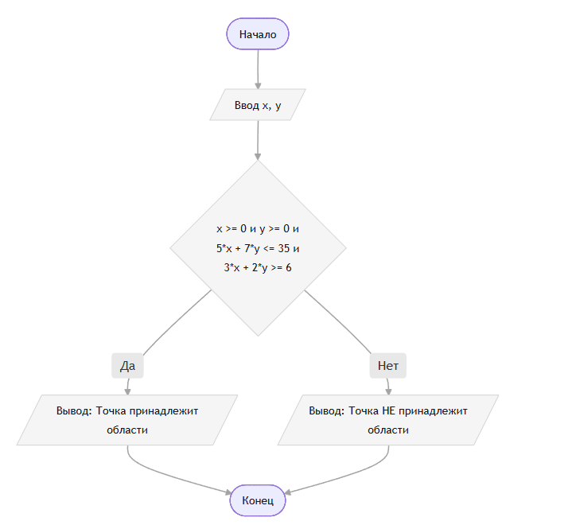

# Домашнее задание к работе 6
## Задача:
Составить программу, которая проверяет принадлежит ли заданная пользователем точка с координатами (х, у) заданным закрашенным (заштрихованным) областям, показанным на рисунках в табл., и выводит на экран сообщение.
## 1. Алгоритм и блок-схема
### Алгоритм
1.Начало программы.
2.Ввод данных: запросить у пользователя действительные числа x и y.
3.Проверка условия:
Вычислить истинность выражения:
(x >= 0) И (y >= 0)  И  (5x + 7y <= 35)  И  (3x + 2y >= 6).
4.Если условие истинно (Да) — вывести на экран сообщение: Точка принадлежит заштрихованной области.
5.Если условие ложно (Нет) — вывести на экран сообщение: Точка не принадлежит заштрихованной области.
6.Конец программы.
### Блок-схема
 
## 2. Реализация программы
#include <stdio.h>
#include <locale.h>

int main(void) {
    double x, y;
    setlocale(LC_CTYPE, "RUS");
    printf("Введите координаты точки (x, y): ");
    if (scanf("%lf %lf", &x, &y) != 2) {
        printf("Ошибка ввода данных.\n");
        return 1;
    }

    /* Проверка принадлежности области */
    if (x >= 0.0 && y >= 0.0 && (5.0 * x + 7.0 * y <= 35.0) && (3.0 * x + 2.0 * y >= 6.0)) {
        printf("Точка (%.2f, %.2f) принадлежит заштрихованной области.\n", x, y);
    }
    else {
        printf("Точка (%.2f, %.2f) НЕ принадлежит заштрихованной области.\n", x, y);
    }

    return 0;
}
## 4. Информация о разработчике
  Овчинников Артём БИЦТ-262
